<p align="center"><a href="README.md">Türkçe</a> · <b>English</b></p>

<p align="center"></p>

## Commands to copy

Text in the picture can't be selected; everything you need to copy is here.

**Install** (Windows, Node.js 20+). `Kur.bat` opens a window: sign in to your own DeepSeek account there:

```bat
git clone https://github.com/yilmazhalilibr/ChatToFree
cd ChatToFree
.\Kur.bat
```

**Check and update:**

```bat
c2f durum
c2f guncelle
```

### Other harnesses and models

The MCP server is `node <folder>/src/mcp.js`, its tool is `advise` (shown as `c2f_advise` or
`mcp__c2f__advise` depending on the client). Give tools a timeout of at least 5 minutes. Full settings:
[`docs/AI-INSTALL.md`](docs/AI-INSTALL.md#5-connect-a-harness).

```bash
claude mcp add c2f -- node <folder>/src/mcp.js
```

```toml
# Codex CLI: ~/.codex/config.toml
[mcp_servers.c2f]
command = "node"
args = ["<folder>/src/mcp.js"]
tool_timeout_sec = 600
```

```json
"c2f": { "command": "node", "args": ["<folder>/src/mcp.js"] }
```

**From a shell** (any agent without MCP, or you). Write the message to a file; quotes, `$`, `%` and
non-English letters survive any shell. The id at the end of an answer continues the same DeepSeek chat:

```bat
c2f danis --file message.txt
c2f danis --file message.txt --thread 5e0c41a7
c2f danis --file message.txt --deep --search
```

**The agent's rules** (for any harness; put the output into `AGENTS.md`, `CLAUDE.md` or `.cursorrules`):

```bat
c2f kurallar --cli > rules.md
```

**Don't make `ctf` the default OpenCode agent:**

```bat
c2f config set ctfDefault false
c2f kur
```

**`.c2fignore`** (in the project folder; a message holding lines from these files is not sent, a lone `off` turns c2f off for that project):

```gitignore
secrets/
config/prod.json
*billing*.py
```

**Burst limit** (not advised; the default is 10 per 10 minutes):

```bat
c2f config set sites.deepseek.limit.burstMax 15
```

The command names are Turkish (`kur` = install, `giris` = sign in, `durum` = status, `guncelle` =
update, `danis` = ask, `kurallar` = rules, `sohbet` = chat); the English names `setup`, `login`,
`status`, `update`, `ask`, `rules` and `chat` work too.

<details>
<summary><b>Files</b> (<code>%LOCALAPPDATA%\ChatToFree\</code>)</summary>

| File | Contents |
|---|---|
| `deepseek-auth.json` | The DeepSeek login. Worth as much as a password: never share, copy or commit it |
| `config.json` | User settings (written by `c2f config set`) |
| `usage.json` | When messages were sent (for the limits) |
| `deepseek-chats.json` | The DeepSeek chats of advisor conversations (to continue after a restart; 30 days) |
| `oc-threads.json` | Which OpenCode session belongs to which conversation (30 days) |
| `threads\*.json` | The last message of each `c2f danis` conversation (for the repeat guard) |
| `sent.log` | Time, chat, size and result of each message; **no message text** |
| `refusals.log` | DeepSeek's refusal/limit replies, in its own words |
| `deepseek.sent` | Send times of the last 10 minutes (for the brake) |
| `oc-sessions.json` | The OpenCode plugin's "this message came from that session" notes of the last two minutes |
| `mcp-sessions.log` | Every start of the c2f server (which folder, which client) |
| `login-profile\` | The browser profile of the sign-in window (not your Chrome profile) |
| `path-backup-*.txt` | PATH before the installer changed it |

OpenCode side: `~/.config/opencode/opencode.jsonc` (the c2f server, the `ctf` agent, the default agent),
`command/ctf_ask.md`, `plugins/c2f-session.js`. The installer leaves your other settings alone and keeps
one `opencode.jsonc.bak-c2f` backup before its first change.

</details>

<details>
<summary><b>Development</b></summary>

| File | Job |
|---|---|
| `src/mcp.js` | MCP server: the `advise` and `status` tools; ties conversations to sessions/threads |
| `src/advisor.js` | Consult rules: length, first person, repeat guard; conversation records |
| `src/deepseek-http.js` | DeepSeek web chat: new chats, proof of work (PoW), stream reading, lock, waits |
| `src/router.js`, `src/limits.js` | Message limits, keeping a chat going |
| `src/login.js` | The sign-in window and reading the login |
| `src/opencode-setup.js` | OpenCode settings, the `ctf` agent and its rules (`agentPrompt`), desktop refresh |
| `.opencode/plugins/c2f-session.js` | OpenCode session plugin (1.x and 2.x) |
| `src/install.js` | PATH install and repair |
| `src/cli.js` | The `c2f` commands |

Run `npm test` before and after every change. The README pictures come from `python tools/readme_svg.py`;
for a new release add an entry at the top of its `CHANGES` list and commit both SVGs together.

</details>

## More

- [`docs/AI-INSTALL.md`](docs/AI-INSTALL.md): install, verify, connect, remove, and the account safety
  rules, written for AI agents. Have an agent read it before you ask it to install ChatToFree.
- [`KULLANIM.md`](KULLANIM.md) (Turkish): the old browser-extension path (ChatGPT, Claude, Gemini) and the automation features.
- [`STATUS.md`](STATUS.md) (Turkish): measurements and history. [`NOTICE`](NOTICE): sources on the DeepSeek protocol.

## License

[MIT](LICENSE). The proof-of-work call in `src/deepseek-http.js` is adapted from FreeDeepseekAPI
(Apache-2.0); see `NOTICE`.

Not an official project; no tie to DeepSeek, OpenAI, Anthropic or Google. It uses the web chats outside
their official APIs, which may break their terms of use. Every risk, account suspension included, is
the user's.
