<p align="center"><b>Türkçe</b> · <a href="README.en.md">English</a></p>

<p align="center"></p>

## Kopyalanacak komutlar

Görseldeki yazılar seçilemiyor; kopyalaman gerekenler burada.

**Kurulum** (Windows, Node.js 20+). Sonra klasördeki `Kur.bat`'a çift tıkla ve açılan pencerede kendi
DeepSeek hesabına gir:

```bat
git clone https://github.com/yilmazhalilibr/ChatToFree
cd ChatToFree
.\Kur.bat
```

**Kontrol ve güncelleme:**

```bat
c2f durum
c2f guncelle
```

### Başka bir harness ya da model

MCP sunucusu `node <klasör>/src/mcp.js`, aracın adı `advise` (istemciye göre `c2f_advise`,
`mcp__c2f__advise`). Araç zaman aşımını en az 5 dakika yap. Ayrıntılı ayarlar:
[`docs/AI-INSTALL.md`](docs/AI-INSTALL.md#5-connect-a-harness).

```bash
claude mcp add c2f -- node <klasör>/src/mcp.js
```

```toml
# Codex CLI: ~/.codex/config.toml
[mcp_servers.c2f]
command = "node"
args = ["<klasör>/src/mcp.js"]
tool_timeout_sec = 600
```

```json
"c2f": { "command": "node", "args": ["<klasör>/src/mcp.js"] }
```

**Kabuktan** (MCP'si olmayan her ajan ya da sen). Mesajı bir dosyaya yaz; tırnak, `$`, `%` ve Türkçe
harfler her kabukta bozulmadan gider. Cevabın sonundaki kimlikle aynı DeepSeek sohbetinde devam edilir:

```bat
c2f danis --file mesaj.txt
c2f danis --file mesaj.txt --thread 5e0c41a7
c2f danis --file mesaj.txt --deep --search
```

**Ajanın kuralları** (her harness'a verilebilir; çıktıyı `AGENTS.md`, `CLAUDE.md` ya da `.cursorrules` içine koy):

```bat
c2f kurallar --cli > kurallar.md
```

**OpenCode'da `ctf` varsayılan olmasın:**

```bat
c2f config set ctfDefault false
c2f kur
```

**`.c2fignore`** (proje klasöründe; bu dosyalardan satır içeren mesaj gönderilmez, tek başına `off` c2f'yi o projede kapatır):

```gitignore
secrets/
config/prod.json
*billing*.py
```

**Kısa sürede çok mesaj sınırı** (önerilmez; varsayılan 10 dakikada 10):

```bat
c2f config set sites.deepseek.limit.burstMax 15
```

<details>
<summary><b>Dosyalar</b> (<code>%LOCALAPPDATA%\ChatToFree\</code>)</summary>

| Dosya | İçerik |
|---|---|
| `deepseek-auth.json` | DeepSeek girişi. Şifre kadar değerlidir: paylaşma, kopyalama, depoya koyma |
| `config.json` | Kullanıcı ayarları (`c2f config set` yazar) |
| `usage.json` | Gönderilen mesajların zamanları (sınırlar için) |
| `deepseek-chats.json` | Danışma konuşmalarının DeepSeek sohbetleri (yeniden başlatmadan sonra aynı sohbette devam için; 30 gün) |
| `oc-threads.json` | Hangi OpenCode oturumunun hangi konuşmaya ait olduğu (30 gün) |
| `threads\*.json` | `c2f danis` konuşmalarının son mesajı (tekrar engeli için) |
| `sent.log` | Her mesaj için zaman, sohbet, boyut ve sonuç; **mesaj metni yok** |
| `refusals.log` | DeepSeek'in ret/limit cevapları, kendi sözleriyle |
| `deepseek.sent` | Son 10 dakikanın gönderim zamanları (fren için) |
| `oc-sessions.json` | OpenCode eklentisinin son iki dakikalık "bu mesaj şu oturumdan" notları |
| `mcp-sessions.log` | c2f sunucusunun her başlangıcı (hangi klasörde, hangi istemciyle) |
| `login-profile\` | Giriş penceresinin tarayıcı profili (senin Chrome profilin değil) |
| `path-backup-*.txt` | Kurulum PATH'i değiştirmeden önceki değer |

OpenCode tarafı: `~/.config/opencode/opencode.jsonc` (c2f sunucusu, `ctf` ajanı, varsayılan ajan),
`command/ctf_ask.md`, `plugins/c2f-session.js`. Kurulum mevcut ayarlarına dokunmaz; değiştirmeden önce
bir kez `opencode.jsonc.bak-c2f` yedeği alır.

</details>

<details>
<summary><b>Geliştirme</b></summary>

| Dosya | Görev |
|---|---|
| `src/mcp.js` | MCP sunucusu: `advise` ve `status` araçları; konuşmaları oturuma/thread'e bağlar |
| `src/advisor.js` | Danışma kuralları: uzunluk, birinci tekil kişi, tekrar engeli; konuşma kayıtları |
| `src/deepseek-http.js` | DeepSeek web sohbeti: sohbet açma, iş kanıtı (PoW), akış okuma, kilit, bekleme |
| `src/router.js`, `src/limits.js` | Mesaj sınırları, sohbetin sürdürülmesi |
| `src/login.js` | Giriş penceresi ve girişin okunması |
| `src/opencode-setup.js` | OpenCode ayarı, `ctf` ajanı ve kurallar (`agentPrompt`), masaüstü yenileme |
| `.opencode/plugins/c2f-session.js` | OpenCode oturum eklentisi (1.x ve 2.x) |
| `src/install.js` | PATH kurulumu ve onarımı |
| `src/cli.js` | `c2f` komutları |

`npm test` her değişiklikten önce ve sonra çalıştırılır. README görselleri `python tools/readme_svg.py`
ile üretilir; yeni sürümde dosyanın başındaki `CHANGES` listesine ekle ve iki SVG'yi birlikte commit'le.

</details>

## Daha fazlası

- [`docs/AI-INSTALL.md`](docs/AI-INSTALL.md): AI ajanları için kurulum, doğrulama, harness bağlantısı,
  kaldırma ve hesap güvenliği kuralları (İngilizce). Bir ajana "ChatToFree'yi kur" demeden önce ona bunu okut.
- [`KULLANIM.md`](KULLANIM.md): eski tarayıcı eklentisi yolu (ChatGPT, Claude, Gemini) ve otomasyon özellikleri.
- [`STATUS.md`](STATUS.md): ölçümler ve geçmiş. [`NOTICE`](NOTICE): DeepSeek protokolü üzerine kaynaklar.

## Lisans

[MIT](LICENSE). `src/deepseek-http.js` içindeki iş kanıtı çağrısı FreeDeepseekAPI'den (Apache-2.0)
uyarlandı; ayrıntı `NOTICE` dosyasında.

Resmi bir proje değildir; DeepSeek, OpenAI, Anthropic ya da Google ile bağlantısı yoktur. Web
sohbetlerini resmi API dışında kullanır, bu sitelerin kullanım şartlarına aykırı olabilir. Hesabın
askıya alınması dahil her risk kullanana aittir.
