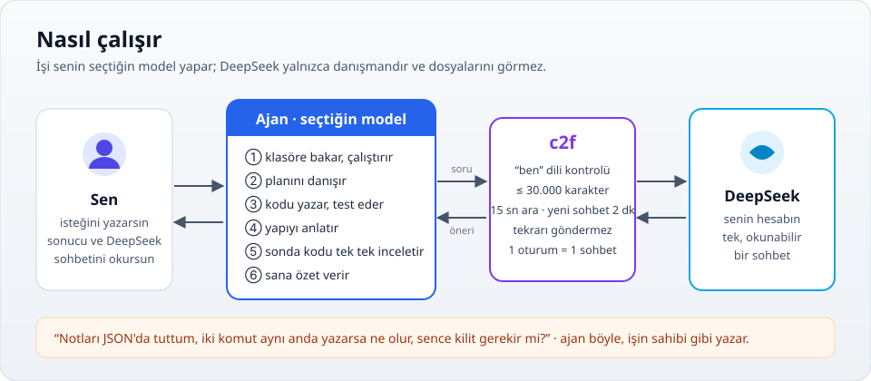
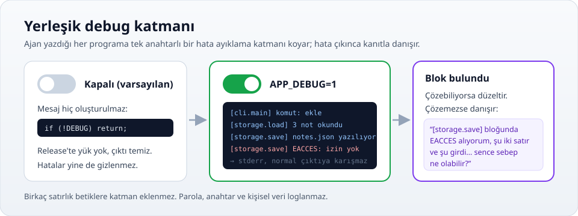
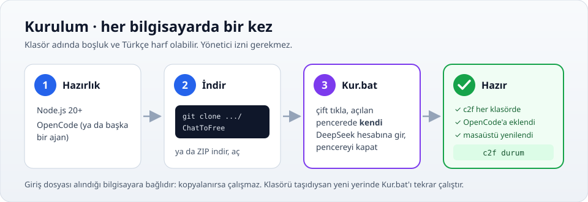
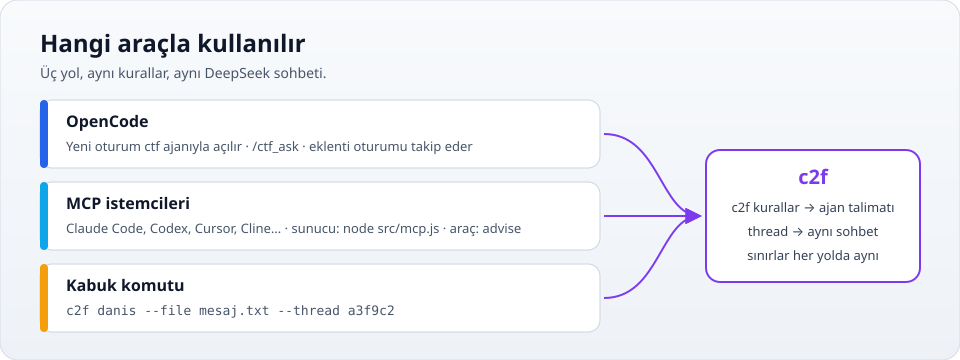
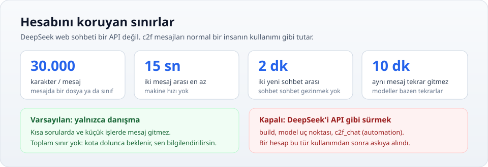

# ChatToFree (c2f)

Bilgisayarındaki kodlama ajanı (OpenCode, Claude Code, Codex, Cursor ya da kabuk komutu çalıştırabilen
herhangi bir model) işi kendisi yapar ve ilerledikçe **kendi DeepSeek hesabındaki** daha güçlü modele
danışır. API anahtarı gerekmez: c2f, DeepSeek'in web sohbetini senin girişinle kullanır. Konuşma
DeepSeek hesabında normal bir sohbet olarak durur; ne sorulduğunu ve ne cevap verildiğini sen de
okuyabilirsin.

> **Hesabını koru.** DeepSeek web sohbeti bir API değil. Bir hesap, bu proje onu makine gibi
> sürerken (kısa sürede çok mesaj, çok yeni sohbet, çok uzun mesajlar) askıya alındı. c2f bu yüzden
> varsayılan olarak yalnızca **danışır**: mesajlar insan diliyle, birinci tekil kişiyle, sınırlı sayıda
> ve aralıklı gider. Risksiz tek yol DeepSeek'in ücretli resmi API'sidir.

**Bu sistemi bir yapay zekâ ajanına mı kurduruyorsun?** Ona önce
[`docs/AI-INSTALL.md`](docs/AI-INSTALL.md) dosyasını okut: kurulum, doğrulama, harness bağlantıları ve
hesabı koruyan kurallar orada adım adım yazıyor.

## Ne yapar

<p align="center"></p>

- **İşi ajan yürütür.** Dosyaları o okur, yazar, çalıştırır ve test eder. DeepSeek dosyaları görmez;
  yalnızca ajanın gönderdiğini okur.
- **Zor kısmı DeepSeek'e yazdırabilir.** Zor bir algoritma, ayrıştırıcı ya da karmaşık bir mantık için
  ajan DeepSeek'ten tam kod ve açıklama ister (dil, imza, girdi/çıktı örneği, sınırlar ve çevresindeki
  kodla birlikte). Sonra kodu anlar, projeye uydurur, test eder; hangi kısmı DeepSeek'in yazdığını söyler.
- **Kendi sözleriyle, duruma göre yazar.** Sabit açılış ya da kalıp cümle yok; c2f mesaja hiçbir şey
  eklemez. Ajan o anki işi, gördüğünü ve neye ihtiyacı olduğunu işin sahibi gibi birinci tekil kişiyle
  anlatır, anlaması gerektiğinde DeepSeek'ten ayrıntılı ve gerekçeli cevap ister. "Kullanıcı şunu
  istiyor" diye yazılmış bir mesaj gönderilmeden reddedilir.
- **Yapıyı da konuşur.** İlk sürüm bir kez çalışınca, test ve yeni özellik eklemeden önce, ve yapı
  değiştikçe: klasörler, kodun nasıl bölündüğü, verinin nasıl aktığı, seçilen teknoloji ve nedeni.
- **Debug katmanı** (aşağıdaki görsel). Ajan yazdığı her programa (birkaç satırlık betikler hariç) tek anahtarla
  (ör. `APP_DEBUG=1`) açılan bir hata ayıklama katmanı koyar. Kapalıyken iş yapmaz; açıkken her satır
  hangi bloktan geldiğini söyler (`[storage.save] ...`). Hata çıktığında anahtarı açar, bloğu bulur;
  çözemezse DeepSeek'e o bloğun adı, ilgili birkaç satır ve hata mesajıyla danışır.
- **Bir oturum, bir sohbet.** Aynı ajan oturumundaki bütün danışmalar DeepSeek'te tek bir sohbette
  ilerler; yeni oturum yeni sohbet açar. c2f sohbetlere ad vermez, adı DeepSeek koyar.
- **Sohbet eder, sonunda kodu tek tek inceletir.** Her adımdan sonra kısa bir mesajla ne yaptığını
  anlatıp sorar. İş bitince DeepSeek'ten ayrıntılı inceleme ister: önce genel yapıyı, sonra her mesajda
  bir dosya ya da sınıfın kodunu yapıştırır (30.000 karaktere kadar, uzunsa parça parça), cevaba göre
  düzeltir, sonrakine geçer.
- **Derin düşündürür.** Zor kod isterken DeepSeek'in DeepThink modunu yalnızca o mesaj için açar
  (MCP'de `deep: true`, kabukta `c2f danis --deep`).
- **Gerektiğinde web'e baktırır.** Cevap yeni bir kütüphane sürümüne ya da değişmiş bir API'ye bağlıysa
  o mesaj için DeepSeek'in web aramasını açar (`search: true` / `--search`).
- **Önerileri körü körüne uygulamaz.** Gelen kodu okuyup anlamadan kullanmaz; paket kurma, dosya silme,
  indirme ya da sistem ayarı içeren bir komutu çalıştırmadan önce sana sorar.
- **Küçük işte danışmaz.** Kısa bir soru, bir açıklama ya da tek satırlık bir düzeltme için mesaj
  gönderilmez.

<p align="center"></p>

## Kurulum (Windows)

<p align="center"></p>

Her bilgisayarda bir kez:

1. **Node.js 20+** ([nodejs.org](https://nodejs.org); yoksa `Kur.bat` winget ile kurmayı teklif eder) ve kullanacağın ajan (ör.
   [OpenCode](https://opencode.ai)) kurulu olsun.
2. Depoyu istediğin klasöre indir. Klasör adında boşluk ya da Türkçe harf olabilir. (Depo şu an
   gizli: indirebilmek için GitHub'da depoya erişimin olmalı.)
   ```
   git clone https://github.com/yilmazhalilibr/ChatToFree
   ```
   (ya da GitHub'dan ZIP olarak indirip aç)
3. **`Kur.bat`**'a çift tıkla. Gerekirse paketleri kurar; sonra açılan pencerede **kendi** DeepSeek
   hesabına giriş yaparsın ve pencereyi kapatırsın. Kurulum ayrıca:
   - `c2f` komutunu her klasörden çalışır hâle getirir (kullanıcı PATH'i; yönetici izni gerekmez),
   - OpenCode'a c2f'yi, `ctf` ajanını, `/ctf_ask` komutunu ve oturum eklentisini ekler,
   - OpenCode masaüstünün arka plan sunucusunu yeniler (açık bir iş varsa yarıda kalır).
4. Kontrol: yeni bir terminalde `c2f durum`.

**Her bilgisayar kendi girişini alır.** Giriş dosyası alındığı bilgisayara bağlıdır; başka bir
bilgisayara kopyalanırsa çalışmaz ve `c2f giris` istenir. Arkadaşların her biri kendi DeepSeek
hesabıyla giriş yapar.

**Klasörü taşıdıysan** ya da adını değiştirdiysen yeni yerinde `Kur.bat`'ı bir kez daha çalıştır.
`c2f durum` eski yeri görünce bunu söyler. Kurulum PATH'teki eski c2f girdisini kaldırır ve PATH'i
değiştirmeden önce eski değeri `%LOCALAPPDATA%\ChatToFree\path-backup-*.txt` olarak saklar.

**Güncelleme:** `c2f guncelle` (ZIP ile kurduysan yeni ZIP'i aynı klasöre açıp `Kur.bat`).

## Kullanım

### OpenCode

Kurulumdan sonra OpenCode'da istediğin modeli seç (yerel bir model, `opencode/big-pickle`, hangisi
olursa) ve isteğini yaz. Yeni oturumlar **`ctf`** ajanıyla açılır; ayrıca bir şey yazman gerekmez.

- Başka bir ajandayken tek seferlik: `/ctf_ask isteğin`. Komut yalnızca senin yazdığını iletir;
  kurallar ajanın gizli sistem talimatındadır ve ekranda görünmez.
- `ctf`'nin varsayılan olmasını istemiyorsan: `c2f config set ctfDefault false`, sonra `c2f kur`.
  OpenCode kendi varsayılanına döner; c2f'yi `/ctf_ask` ya da ajan seçiciden `ctf` ile kullanırsın.
- OpenCode'un komut satırı (`opencode run`) ve masaüstü uygulaması aynı ayarları kullanır.

### Başka bir harness ya da model

<p align="center"></p>

OpenCode dışında c2f'ye iki yoldan ulaşılır. İkisinde de konuşma ve kurallar aynıdır. Ayrıntılı
ayarlar: [`docs/AI-INSTALL.md`](docs/AI-INSTALL.md#5-connect-a-harness).

**1. MCP aracı** (MCP destekleyen her araç). Sunucu: `node <klasör>/src/mcp.js`. Aracın adı `advise`'dır
(istemciye göre `c2f_advise`, `mcp__c2f__advise` gibi görünür). Bir danışma DeepSeek'in cevap süresine
ve iki mesaj arasındaki en az 15 saniyelik beklemeye bağlıdır; istemcinin araç zaman aşımını en az
5 dakika yap.

| Araç | Ekleme |
|---|---|
| Claude Code | `claude mcp add c2f -- node D:/yol/ChatToFree/src/mcp.js` |
| Codex CLI | `~/.codex/config.toml`: `[mcp_servers.c2f]` altında `command = "node"`, `args = ["D:/yol/ChatToFree/src/mcp.js"]`, `tool_timeout_sec = 600` |
| Cursor, Cline, Windsurf, Claude Desktop vb. | MCP ayar dosyasında: `"c2f": { "command": "node", "args": ["D:/yol/ChatToFree/src/mcp.js"] }` |

**2. Kabuk komutu** (MCP'si olmayan her ajan, ya da kabuktan kendin). Mesajı bir dosyaya yaz ve
dosyayı ver; tırnak, `$`, ters tırnak, `%` ve Türkçe harfler hangi kabuk olursa olsun bozulmadan gider:

```
c2f danis --file mesaj.txt
...cevap...
(thread: a3f9c2)

c2f danis --file mesaj.txt --thread a3f9c2
```

Bash'te mesaj stdin'den de verilebilir (`c2f danis --thread a3f9c2 <<'EOF' ... EOF`). Windows
PowerShell 5.1'de boru (`|`) Türkçe harfleri `?` yapar; orada `--file` kullan. Kısa, tek satırlık bir
mesaj tırnak içinde de olur (`c2f danis "kısa soru"`). `--thread` aynı DeepSeek sohbetinde devam
ettirir; konuşma diskte tutulduğu için her çağrı ayrı bir süreç olabilir. Kimlik verilmezse yeni
sohbet açılır.

**Ajanın kuralları.** Ajanın nasıl çalışacağını ve DeepSeek'e nasıl yazacağını anlatan talimat tek bir
yerde durur ve her harness'a verilebilir:

```
c2f kurallar         > kurallar.md    # MCP aracıyla danışan ajan için
c2f kurallar --cli   > kurallar.md    # c2f danis komutuyla danışan ajan için
```

Çıktıyı ajanın sistem talimatına ya da kural dosyasına ekle (`AGENTS.md`, `CLAUDE.md`,
`.cursorrules`, Codex `AGENTS.md` ...).

**Oturum takibi.** OpenCode'da hangi oturumun hangi DeepSeek sohbetine ait olduğunu kurulan eklenti
(`~/.config/opencode/plugins/c2f-session.js`) bildirir. Diğer araçlarda bunu ajanın her cevabın
sonundaki `(thread: ...)` kimliğini bir sonraki çağrıda geri göndermesi sağlar (kurallarda yazar). Ajan
unutursa o çağrı yeni bir sohbet açar.

## Komutlar

| Komut | Ne yapar |
|---|---|
| `c2f kur` | İlk kurulum ya da güncelleme sonrası: giriş, PATH, OpenCode, masaüstü yenileme |
| `c2f giris` | DeepSeek girişini yenile (yeni bilgisayar, eskimiş giriş) |
| `c2f durum` | Giriş geçerli mi, OpenCode bu klasöre bağlı mı, bekleme var mı, DeepSeek'in iş kanıtı modülü açılıyor mu (değiştiyse yenisini bulur), bugün kaç mesaj gitti, yeni sürüm var mı |
| `c2f guncelle` | En yeni sürümü alır (`git pull`, `npm install`) ve yeniden kurar (OpenCode masaüstü dahil) |
| `c2f danis --file mesaj.txt [--thread id]` | DeepSeek'e danış; her harness kabuktan kullanabilir |
| `c2f kurallar [--cli]` | Ajan kurallarını yazdır |
| `c2f sohbet` | DeepSeek ile terminalden konuş (`/yeni` yeni sohbet) |
| `c2f config` | Ayarları göster; `c2f config set <anahtar> <değer>` ile değiştir |

## Bir projeyi korumak: `.c2fignore`

Proje klasörüne bir `.c2fignore` dosyası koy:

```
# DeepSeek'e asla gönderilmeyecek dosyalar (.gitignore gibi)
secrets/
config/prod.json
*billing*.py
```

Bu dosyalardaki satırları içeren bir mesaj gönderilmez; ajan onları kendi sözleriyle anlatır. Tam yol
yazılan kurallar (`config/prod.json`, `secrets/`) doğrudan çözülür; joker kurallar `node_modules`, `.venv`,
`dist` gibi ağır klasörlere bakmaz. Çok büyük bir projede her dosya kontrol edilemezse mesaj yine
gönderilmez ve tam yol yazman istenir. Dosyaya
tek başına `off` yazarsan c2f o projede hiç danışmaz (şirket kodu gibi tamamen gizli projeler için).

## Sınırlar ve hesap güvenliği

<p align="center"></p>

| Sınır | Değer | Neden |
|---|---|---|
| Mesaj uzunluğu | 30.000 karakter | Bir dosya ya da sınıf sığar; DeepSeek'in sınırı yaklaşık 40.000 |
| İki mesaj arası | en az 15 sn | Makine hızında mesaj gitmesin |
| İki yeni sohbet arası | en az 2 dk | Her mesajı yeni bir sohbette açmak askıya alınan hesabın düzeniydi |
| Kısa sürede çok mesaj | 10 dakikada en çok 10 (fazlası bekler; 4 dk'dan uzun bekleme gerekirse ajana "HH:MM'den sonra danış" denir) | Hesap ~11 dakikada 25 mesajdan sonra askıya alınmıştı. `c2f config set sites.deepseek.limit.burstMax 15` / `burstMinutes` ile ayarlanır |
| Toplam mesaj | sınır yok | DeepSeek'in kendi kotası belirler |
| Gizli bilgi | parola, API anahtarı, token, özel anahtar içeren mesaj **gönderilmez** | Ajandan değeri `<API_KEY>` gibi bir yer tutucuyla değiştirmesi istenir |
| Aynı mesaj tekrarı | 10 dk içinde gönderilmez | Modeller bazen aynı çağrıyı tekrarlar |
| "Çok sık mesaj" cevabı | aynı sohbette 30 / 60 / 120 sn bekleyip tekrar; yine olmazsa 10 dk ara | Kısa süreli; ajan işine devam eder, sonra yine danışır |
| Kota doldu (günlük limit ya da 15 dk'dan uzak açılış saati) | **hiç tekrar denenmez**; DeepSeek'in verdiği saate (yoksa 1 saat) kadar mesaj gitmez | Bitmiş kotaya her deneme boşa bir istek olur |

Bekletmeler mesajı reddetmez, sıraya koyar. Kota dolduğunda ajan sana "DeepSeek kotası doldu, HH:MM'de
açılır" der ve işi kendi bitirir; sistem bozulmaz. `c2f durum` açılış saatini gösterir.

- Bekleme süreleri **bilgisayar başına** tutulur. Aynı hesabı aynı anda iki bilgisayarda kullanma.
- c2f, DeepSeek'i bir model ya da API gibi süren eski özellikleri (`build`, OpenAI uyumlu uç nokta,
  `c2f_chat`) varsayılan olarak kapalı tutar. Açmak için `c2f config set automation true` gerekir;
  hesabın askıya alınmasının olası sebebi bu kullanım olduğu için önerilmez.
- c2f tarayıcı parmak izi ya da başka bir tespit atlatma yöntemi kullanmaz.

## Dosyalar

Hepsi `%LOCALAPPDATA%\ChatToFree\` altında, yalnızca bu bilgisayarda ve bu Windows kullanıcısında:

| Dosya | İçerik |
|---|---|
| `deepseek-auth.json` | DeepSeek girişi. Şifre kadar değerlidir: paylaşma, kopyalama, depoya koyma |
| `config.json` | Kullanıcı ayarları (`c2f config set` yazar) |
| `usage.json` | Gönderilen mesajların zamanları (sınırlar için) |
| `deepseek-chats.json` | Danışma konuşmalarının DeepSeek sohbetleri (yeniden başlatmadan sonra aynı sohbette devam için; 30 gün) |
| `oc-threads.json` | Hangi OpenCode oturumunun hangi konuşmaya ait olduğu (30 gün) |
| `threads\*.json` | `c2f danis` konuşmalarının son mesajı (tekrar engeli için) |
| `sent.log` | Her mesaj için zaman, sohbet, boyut ve sonuç; **mesaj metni yok** |
| `refusals.log` | DeepSeek'in ret/limit cevapları, kendi sözleriyle |
| `deepseek.sent` | Son 10 dakikanın gönderim zamanları (fren için) |
| `oc-sessions.json` | OpenCode eklentisinin son iki dakikalık "bu mesaj şu oturumdan" notları |
| `mcp-sessions.log` | c2f sunucusunun her başlangıcı (hangi klasörde, hangi istemciyle) |
| `login-profile\` | Giriş penceresinin tarayıcı profili (senin Chrome profilin değil) |
| `path-backup-*.txt` | Kurulum PATH'i değiştirmeden önceki değer |

OpenCode tarafı: `~/.config/opencode/opencode.jsonc` (c2f sunucusu, `ctf` ajanı, varsayılan ajan),
`command/ctf_ask.md`, `plugins/c2f-session.js`. Kurulum mevcut ayarlarına dokunmaz; değiştirmeden önce
bir kez `opencode.jsonc.bak-c2f` yedeği alır.

## Sorun giderme

| Belirti | Çözüm |
|---|---|
| Ajan "c2f_advise aracı yok" diyor | `c2f kur` (OpenCode masaüstünün arka plan sunucusunu da yeniler), sonra yeni oturum aç |
| `c2f durum`: "eski bir klasörü gösteriyor" | Klasör taşınmış: yeni yerinde `c2f kur` |
| "başka bir bilgisayarda alınmış" | `c2f giris` |
| "DeepSeek girişi eskimiş" | `c2f giris` |
| "DeepSeek asked to slow down" | Kısa bekleme; ajan işe devam eder, belirtilen saatten sonra yine danışır |
| "DeepSeek's quota is used up" / "kotası doldu" | Açılış saatine kadar bekle; ajan işi kendi bitirir, sistem bozulmaz |
| Aynı oturum DeepSeek'te yeni sohbet açtı | OpenCode dışındaki araçta ajan `thread` kimliğini göndermemiştir; kuralları (`c2f kurallar`) ajanın talimatına ekle |

## AI ajanları için

Kurulumu, doğrulamayı, harness bağlantılarını, güncellemeyi, kaldırmayı ve uyulması zorunlu hesap
güvenliği kurallarını anlatan ayrıntılı rehber: **[`docs/AI-INSTALL.md`](docs/AI-INSTALL.md)**
(İngilizce). Bir ajana "ChatToFree'yi kur" demeden önce ona bu dosyayı okut.

## Geliştirme

| Dosya | Görev |
|---|---|
| `src/mcp.js` | MCP sunucusu: `advise` ve `status` araçları; konuşmaları oturuma/thread'e bağlar |
| `src/advisor.js` | Danışma kuralları: uzunluk, birinci tekil kişi, tekrar engeli; konuşma kayıtları |
| `src/deepseek-http.js` | DeepSeek web sohbeti: sohbet açma, iş kanıtı (PoW), akış okuma, kilit, bekleme |
| `src/router.js`, `src/limits.js` | Mesaj sınırları, sohbetin sürdürülmesi |
| `src/login.js` | Giriş penceresi ve girişin okunması |
| `src/opencode-setup.js` | OpenCode ayarı, `ctf` ajanı ve kurallar (`agentPrompt`), masaüstü yenileme |
| `.opencode/plugins/c2f-session.js` | OpenCode oturum eklentisi (1.x ve 2.x) |
| `src/install.js` | PATH kurulumu ve onarımı |
| `src/cli.js` | `c2f` komutları |

`npm test` her değişiklikten önce ve sonra çalıştırılır. Ayrıntılı ölçümler ve geçmiş: `STATUS.md`;
eski tarayıcı eklentisi yolu (ChatGPT, Claude, Gemini) ve otomasyon özellikleri: `KULLANIM.md`.
DeepSeek protokolü üzerine kaynaklar: `NOTICE`.

## Lisans

[MIT](LICENSE). `src/deepseek-http.js` içindeki iş kanıtı çağrısı FreeDeepseekAPI'den (Apache-2.0)
uyarlandı; ayrıntı `NOTICE` dosyasında.

Resmi bir proje değildir; DeepSeek, OpenAI, Anthropic ya da Google ile bağlantısı yoktur. Web
sohbetlerini resmi API dışında kullanır, bu sitelerin kullanım şartlarına aykırı olabilir. Hesabın
askıya alınması dahil her risk kullanana aittir.
